# SlotDrop

**Parcel handover slot-scheduling for apartment societies in India.**
The guard logs a parcel at the gate, the resident books an exact handover slot (like booking a doctor), and the parcel is released only after OTP or QR verification.

<p>
  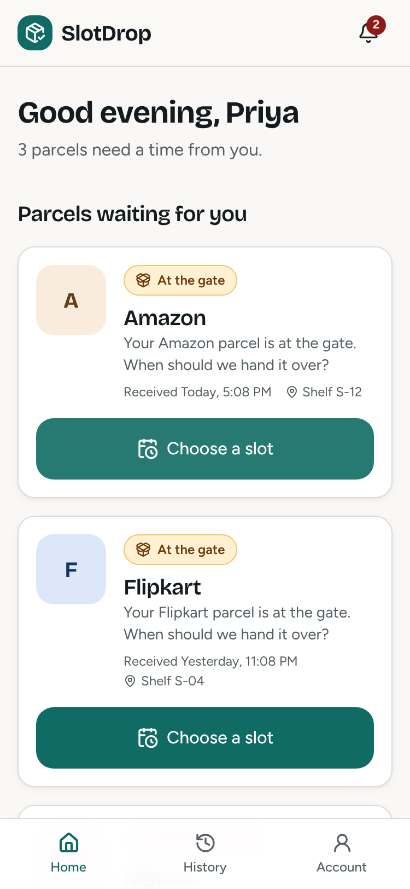
  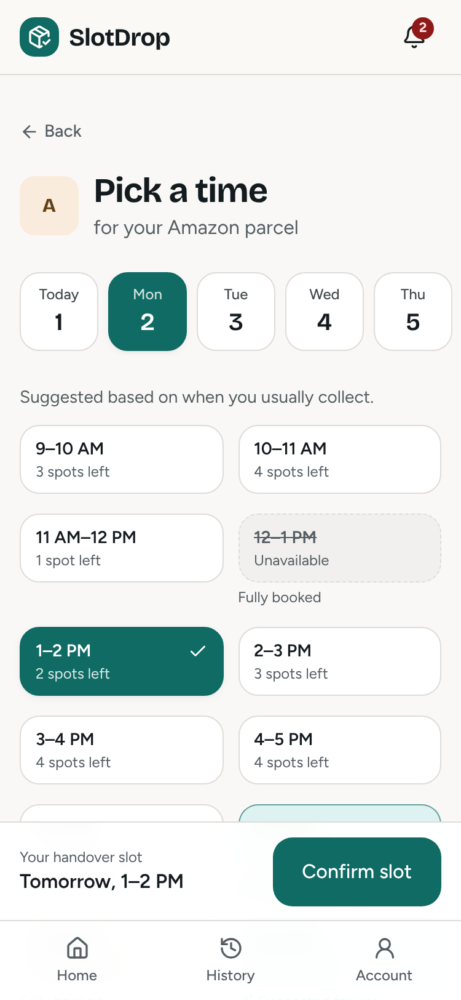
  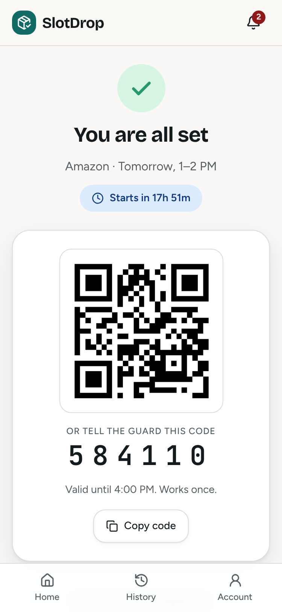
  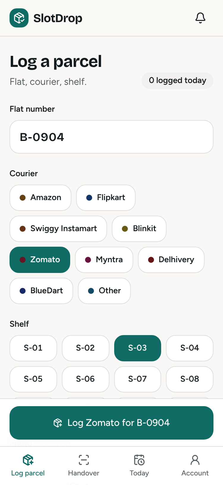
  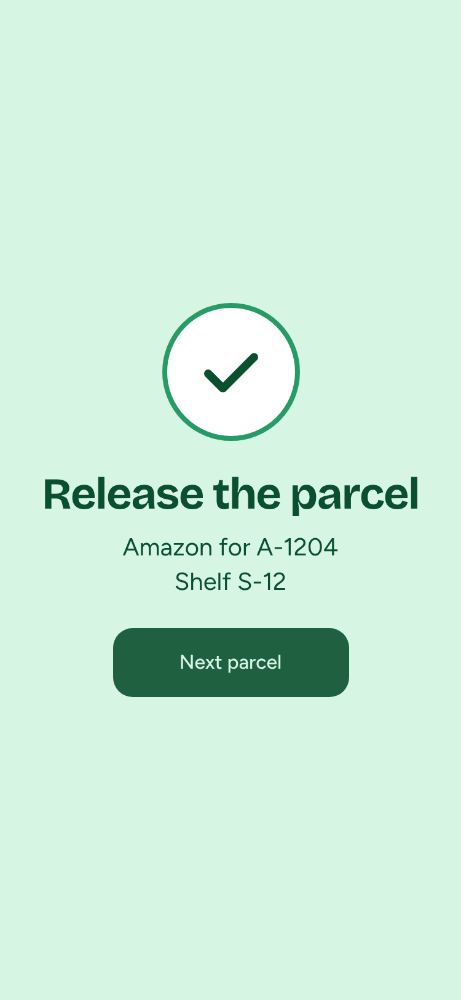
</p>
<p>
  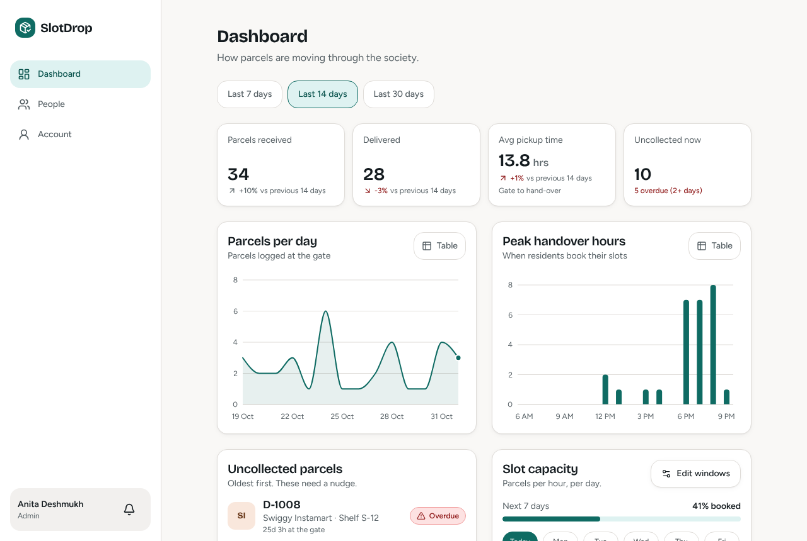
  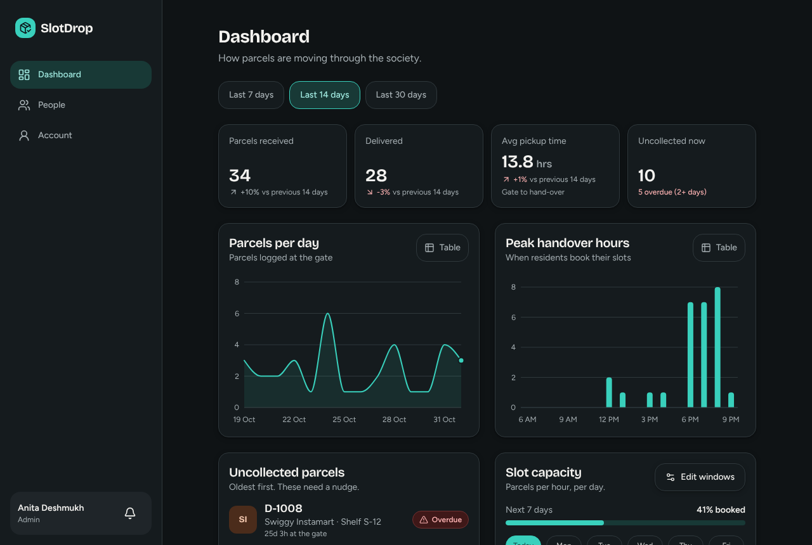
</p>

## The problem

Couriers say "arriving today" with no time window. In a society with hundreds of flats, security receives the parcels but residents have no say in when they are handed over, so deliveries are missed and parcels pile up at the gate.

## How SlotDrop fixes it

1. **Guard logs the parcel** (flat, courier, shelf, optional photo) in a few taps. The resident is notified instantly.
2. **Resident picks a one-hour slot.** Slots show remaining capacity; full ones are disabled with a reason; a smart suggestion is based on when the resident usually collects.
3. **Resident gets a QR and a 6-digit OTP.** They can also share a one-time code with a neighbour.
4. **Guard scans the QR or types flat + OTP.** Big green or red feedback. Each code works once and expires.

## Features

| Role | What they can do |
|---|---|
| **Resident** | See parcels waiting, book a slot with optimistic UI, get OTP + QR + countdown, share a pickup code with a neighbour, add to calendar, cancel/reschedule, parcel history timeline, in-app notifications |
| **Guard** | Quick-log a parcel (camera, flat autocomplete, courier chips, shelf selector), hand over by QR scan or OTP/delegate code, see today's slot-wise schedule |
| **Admin** | Dashboard (KPIs, parcels per day, peak hours, average pickup time, uncollected list), slot-window and per-slot capacity manager, manage people and flats |
| **System** | Hourly cron reminder for parcels uncollected after 48 hours, audit log of every status change, realtime updates over Socket.io |

## Tech stack

React 19 · Vite · Tailwind CSS 3 · Radix UI (shadcn-style components) · Framer Motion · Recharts · lucide-react · html5-qrcode
Node.js · Express · MongoDB + Mongoose · Socket.io · JWT · bcrypt · zod · multer · qrcode · node-cron · Jest + supertest
Deploy target: Vercel (client) + Render (server) + MongoDB Atlas. See [docs/deployment.md](docs/deployment.md).

## What has been verified (read this before a demo or viva)

| Area | Status |
|---|---|
| Server logic that needs no database (OTP derivation, QR tokens, suggestion scoring, analytics aggregation, request validation, seed-data consistency, date handling) | **78 tests pass** (`npm run test:nodb`) |
| Whole client UI against the built-in mock API: all three roles, realtime between tabs, RBAC redirects, charts, capacity manager, people and flats, 375px and 1280px layout, 44px tap targets, keyboard, reduced motion | **80 browser checks pass** (`npm run e2e` in `client/`) |
| Accessibility: Lighthouse on every screen and modal, light + dark, mobile + desktop | **60 snapshots, all score 100** (`npm run a11y` in `client/`) |
| **Server tests that need MongoDB** (concurrent-booking capacity, OTP verification flow, role access matrix, admin endpoints): 29 tests written | **Not yet run.** The build sandbox could not download a MongoDB binary. Run `cd server && npm test` on a machine with MongoDB or Docker |
| **Seed script** (`npm run seed`) writing to a real database | **Not yet run** (the data it generates is unit-tested) |
| **Client talking to the real server** over REST and Socket.io | **Not yet run end to end** |
| **QR scanning with a real camera** | **Not yet tested** (headless browser has no camera; the code-entry fallback is tested) |
| Deployment to Vercel / Render / Atlas | **Not yet done** |

Run the "not yet run" items once on your own machine before you present, and record the results.

## Quick start

### Option A: try the whole UI in 60 seconds (no database)

```bash
cd client
npm install
VITE_API_MODE=mock npm run dev
```

Open http://localhost:5173. Everything runs in the browser with demo data. Open a second tab to sign in as a different role (the login is per tab) and watch the two tabs update each other live.

### Option B: full stack

Prerequisites: Node 22 LTS (everything here was built and tested on Node 22; Vite 8 and Express 5 expect a recent Node), and MongoDB running locally (`mongod`, or `docker run -p 27017:27017 mongo`) or an Atlas connection string.

```bash
# 1. server
cd server
cp .env.example .env        # then set JWT_SECRET and OTP_SECRET to two different long random strings
npm install
npm run seed                # demo data: 1 admin, 2 guards, 10 residents, 30 parcels, ~200 slots
npm run dev                 # API on http://localhost:5000
```

```bash
# 2. client (new terminal)
cd client
npm install
npm run dev                 # http://localhost:5173, proxies /api and /socket.io to :5000
```

Generate secrets with: `node -e "console.log(require('crypto').randomBytes(48).toString('hex'))"`

### Demo logins

Password for all accounts: `SlotDrop@123`

| Role | Login |
|---|---|
| Resident (Priya Sharma, flat A-1204) | `priya.sharma@slotdrop.in` |
| Guard (Ramesh Kumar) | `guard1@slotdrop.in` (also `guard2@slotdrop.in`) |
| Admin (Anita Deshmukh) | `admin@slotdrop.in` |

The login screen has tap-to-fill buttons for these. Other residents follow the pattern `firstname.lastname@slotdrop.in`.

## Environment variables

**server/.env** (see `server/.env.example`)

| Variable | Purpose |
|---|---|
| `MONGODB_URI` | MongoDB connection string |
| `JWT_SECRET` | Signs login tokens. Server refuses to start without it (outside tests) |
| `OTP_SECRET` | Derives OTPs and signs QR tokens. **Must differ from `JWT_SECRET`** |
| `JWT_EXPIRES_IN` | Token lifetime, default `7d` |
| `CLIENT_ORIGIN` | Exact origin allowed by CORS and Socket.io, e.g. `https://slotdrop.vercel.app` (no trailing slash) |
| `PORT` | Default `5000` (Render sets it automatically) |

**client/.env** (see `client/.env.example`)

| Variable | Purpose |
|---|---|
| `VITE_API_MODE` | `api` (real server, default) or `mock` (in-browser demo data) |
| `VITE_API_URL` | Server URL in production. Leave empty in development (Vite proxies) |

## Scripts

| Where | Command | What it does |
|---|---|---|
| server | `npm run dev` / `npm start` | Run the API (nodemon / node) |
| server | `npm run seed` | Wipe and load demo data (refuses in production unless `-- --force`) |
| server | `npm test` | All Jest tests (**needs MongoDB access**; downloads an in-memory MongoDB) |
| server | `npm run test:nodb` | The 78 tests that need no database |
| client | `npm run dev` / `npm run build` | Vite dev server / production build |
| client | `npm run e2e` | 80 browser checks in mock mode (start a mock-mode dev server first) |
| client | `npm run a11y` | Lighthouse accessibility audit of every screen |
| client | `npm run check:contrast` | WCAG AA contrast check of every design token pair, light and dark |

## Project structure

```
slotdrop/
├─ server/src/
│  ├─ routes/ controllers/      thin HTTP layer
│  ├─ services/                 business logic: booking, otp, handover, delegation, suggestion, analytics, audit, notifications
│  ├─ models/                   Mongoose schemas
│  ├─ middleware/               auth, requireRole, validate (zod), rateLimit, upload, error
│  ├─ sockets/ jobs/            Socket.io, cron (reminders, slot generation)
│  ├─ seed/                     pure data builder + runner
│  └─ utils/ config/
├─ server/tests/                Jest (DB-free and DB-backed)
├─ client/src/
│  ├─ components/ui/            design-system components (Button, Card, StatusChip, SlotChip, Stepper, QRCard, EmptyState, Toast, Modal, Skeleton, ...)
│  ├─ components/layout|admin|parcel|charts/
│  ├─ pages/ resident|guard|admin
│  ├─ lib/ context/ mocks/      API clients (real + mock), state, formatting
│  └─ styles/tokens.css         light/dark design tokens
├─ client/scripts/              e2e, Lighthouse audit, contrast check
└─ docs/                        deployment, demo script, viva Q&A, project report
```

The design system is browsable at `/design-system` while the client is running.

## Architecture

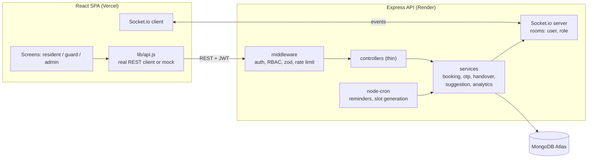

### Data model

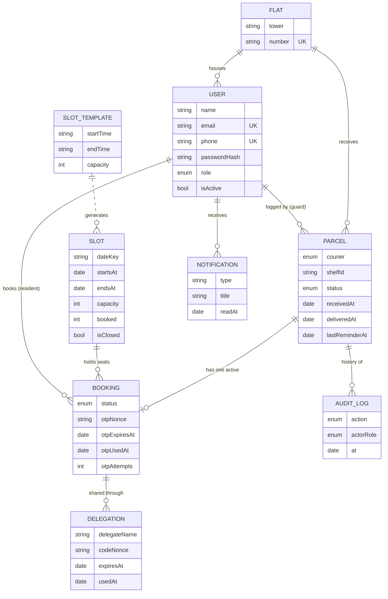

Parcel status is `RECEIVED → SLOT_BOOKED → DELIVERED`. "Overdue" is not stored: it is derived (still `RECEIVED` after 48 hours).

### Booking without overbooking

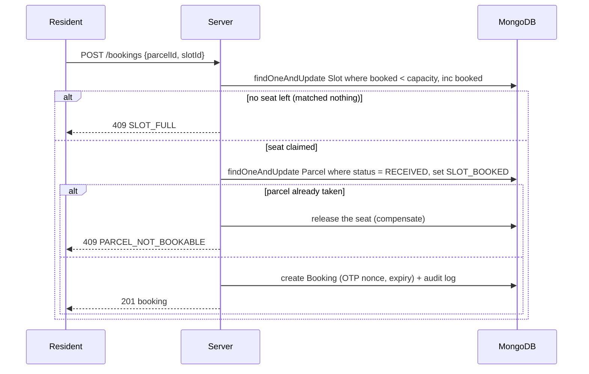

### Handover

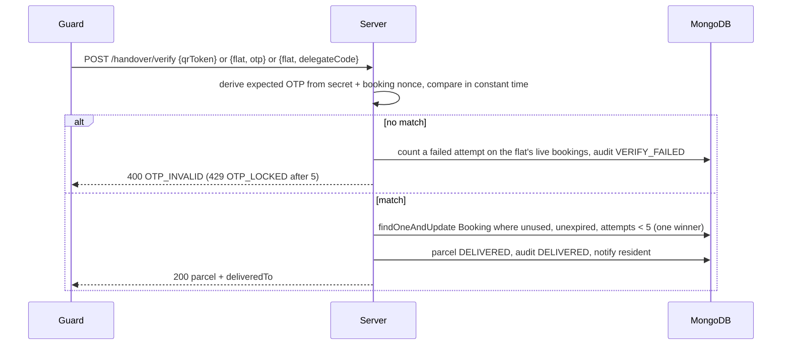

## API reference

Base path `/api`. Success: `{ "data": ... }`. Failure: `{ "error": { "code", "message", "details?" } }`. Auth: `Authorization: Bearer <token>`.

| Method | Path | Role | Notes |
|---|---|---|---|
| GET | `/health` | public | Uptime check |
| POST | `/auth/login` | public | `{identifier, password}` (email or mobile) → `{token, user}`. 10 attempts / 15 min / IP |
| GET | `/auth/me` | any | Current user with flat |
| POST | `/auth/register` | admin | `{name, email, phone, password, role, flatId?}`; residents need a flat |
| GET | `/users?role=` | admin | List people |
| PATCH | `/users/:id/active` | admin | `{isActive}`; cannot deactivate yourself |
| GET | `/flats/search?q=` | guard, admin | Autocomplete, max 8 |
| GET, POST | `/flats` | admin | List / create (`{tower, number, floor?}`) |
| POST | `/parcels` | guard | multipart: `flatId, courier, shelfId?, photo?` (JPG/PNG/WebP, 5 MB) |
| GET | `/parcels?status=&limit=` | any | Residents only ever see their own flat |
| GET | `/parcels/:id`, `/parcels/:id/timeline` | owner, guard, admin | Timeline is the audit trail (no OTP data) |
| GET | `/slots?date=YYYY-MM-DD` | any | Each slot: `remaining`, `reason` (why unavailable), `suggested`, `suggestedReason` |
| GET | `/slots/today` | guard, admin | Slot-wise schedule with bookings (never includes OTPs) |
| PATCH | `/slots/:id` | admin | `{capacity?, isClosed?}`; capacity cannot go below booked seats |
| GET, PUT | `/admin/slot-templates` | admin | Daily windows; saving re-syncs the next 7 days without touching booked slots |
| GET | `/admin/analytics?range=7\|14\|30` | admin | KPIs, parcels per day, peak hours, uncollected list |
| POST | `/bookings` | resident | `{parcelId, slotId}` → booking. Atomic capacity |
| GET | `/bookings` | resident | Own bookings |
| GET | `/bookings/:id` | resident (owner) | The only place the OTP, QR image and delegate codes are returned |
| POST | `/bookings/:id/delegate` | resident (owner) | `{delegateName, delegatePhone?, hours?}` → one-time `code`. Max 3 active |
| DELETE | `/bookings/:id` | resident (owner) | Releases the seat; parcel returns to `RECEIVED` |
| POST | `/handover/verify` | guard | One of `{qrToken}`, `{flat, otp}`, `{flat, delegateCode}`. 30 / min / IP |
| GET | `/notifications` | any | `{notifications, unread}` |
| PATCH, POST | `/notifications/:id/read`, `/notifications/read-all` | any | Mark read |

Error codes you will see: `VALIDATION_ERROR` (400, with per-field `details`), `UNAUTHORIZED` (401), `INVALID_CREDENTIALS` (401), `FORBIDDEN` (403), `NOT_FOUND` (404), `SLOT_FULL` / `PARCEL_NOT_BOOKABLE` / `CAPACITY_BELOW_BOOKED` / `DELEGATION_LIMIT` / `DUPLICATE` / `OTP_USED` (409), `OTP_INVALID` (400), `OTP_EXPIRED` (410), `OTP_LOCKED` / `RATE_LIMITED` (429).

**Realtime** (Socket.io, JWT in `auth.token` of the handshake): `parcel:new`, `parcel:updated`, `slot:updated`, `notification:new`. Users join `user:<id>` and `role:<role>` rooms.

## Security design in brief

- **OTPs are never stored.** An OTP is `HMAC-SHA256(OTP_SECRET, bookingId + random nonce)` reduced to 6 digits. The database holds only the nonce, so a database leak does not reveal OTPs; the owning resident can re-open the screen and see the same OTP. Comparison is constant-time.
- **Single use, expiry, lockout.** A booking is consumed by one conditional update, so concurrent scans produce exactly one success. Expiry is the slot end plus 2 hours. Five wrong guesses lock the flat's live bookings.
- **QR carries a signed token**, not the OTP, signed with `OTP_SECRET` (separate from the login JWT secret).
- **Guards and admins never receive OTP material.** Only `GET /bookings/:id` for the booking's own resident does.
- Passwords hashed with bcrypt; login does the same work for unknown users (no user enumeration); every request re-checks that the account is still active.
- Every input is validated with zod (including query strings, which blocks operator injection like `?role[$ne]=admin`). Helmet, CORS pinned to one origin, three rate limiters, uploads restricted by MIME type with server-chosen filenames.
- Every status change appends an audit log entry; the model rejects updates and deletes.

## Known limitations

- Single society per deployment (no tenant isolation).
- Photos are stored on local disk. On Render this is ephemeral; swap `services/storageService.js` for Cloudinary or S3 for production.
- Reminders run with `node-cron` inside the web process. A sleeping free-tier instance misses them.
- Booking uses a compensating action instead of a multi-document transaction (works on standalone MongoDB). A crash between claiming the seat and claiming the parcel could leak one seat; Atlas transactions or a reconciliation job would close this.
- Only the resident who booked can see the pass; flat-mates cannot (they can still be given a delegate code).
- In-app notifications only (no SMS or WhatsApp). No refresh tokens; tokens last 7 days.
- Analytics are computed in application code from recent rows. Fine for hundreds of parcels per day; use MongoDB aggregation or pre-aggregated counters beyond that.

## More documents

- [Deployment guide](docs/deployment.md): Vercel + Render + Atlas
- [5-minute demo script](docs/demo-script.md)
- [Viva questions and answers](docs/viva-qa.md)
- [Project report draft](docs/project-report.md)
