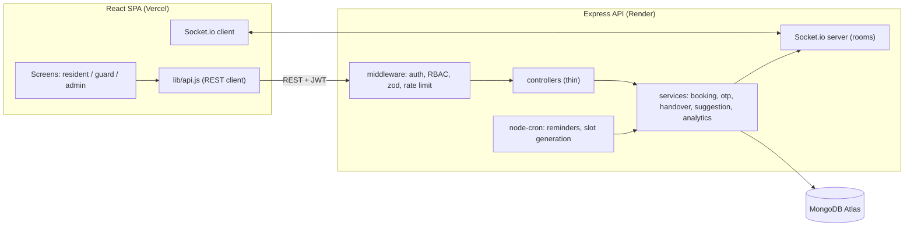
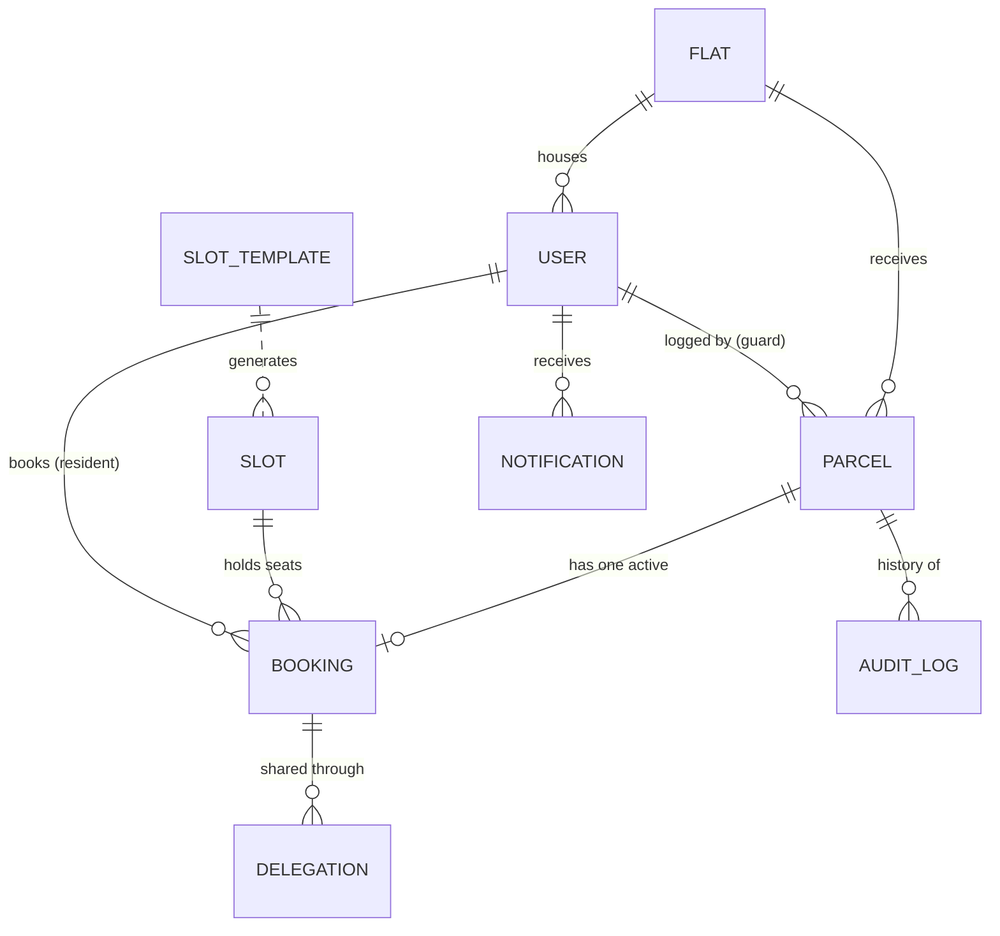

# SlotDrop: A Slot-Scheduling and OTP-Verified Handover System for Parcels in Apartment Societies

**Project report (draft)**

| | |
|---|---|
| Student(s) | [Name(s), roll number(s)] |
| Guide | [Name, designation] |
| Department / Institution | [Department, college, university] |
| Degree / Year | B.E./B.Tech, Fourth Year, [Academic year] |
| Submission date | [Date] |

> **How to use this draft.** Text in `[square brackets]` is yours to fill in. Sections marked **(run and record)** need results from running the project on your own machine. Mermaid diagrams render on GitHub or at mermaid.live; export them as images for the final document. Reformat citations to your college's template. Keep the "Limitations" section: honesty about what was and was not tested is a strength in evaluation.

---

## Abstract

Parcel and food-delivery volumes in Indian apartment societies have grown to hundreds of deliveries per day. Couriers announce only "arriving today", security staff receive and store the parcels, and residents have no control over when a parcel is handed over, so deliveries are missed and parcels accumulate at the gate. This project presents **SlotDrop**, a web application in which the security guard logs each parcel at the gate, the resident is notified immediately and books an exact one-hour handover slot (in the manner of booking a doctor's appointment), and the parcel is released only after the resident presents a one-time QR code or six-digit OTP.

SlotDrop has three roles (resident, guard, administrator). Its central technical contributions are: (i) **atomic slot-capacity enforcement** using a single conditional database update, so that concurrent requests cannot overbook a slot; (ii) an **OTP scheme that never stores the OTP**, deriving it from a server secret and a per-booking random value, with single-use consumption, expiry, and attempt lockout; (iii) **delegated pickup** through a temporary neighbour code; (iv) a **personalised slot suggestion** based on a recency-weighted histogram of the resident's past pickup hours; and (v) an append-only **audit trail** and an administrator **dashboard**. The system is built with React, Node.js/Express, MongoDB and Socket.io, and is designed to be deployed on Vercel, Render and MongoDB Atlas.

Verification consists of 78 automated server tests that need no database, 80 automated browser checks covering every role, and an accessibility audit scoring 100 on all 60 tested screen configurations. Database-backed tests (including a concurrent-booking test) are implemented and are to be run in a MongoDB environment **[record the result here]**. No field study with a real society has yet been conducted; the effect on missed deliveries is therefore a hypothesis for future work.

**Keywords:** parcel management, appointment scheduling, one-time password, HMAC, concurrency control, MongoDB, residential society, accessibility.

---

## 1. Introduction

### 1.1 Background

Large gated communities in Indian cities receive parcels from e-commerce and quick-commerce services throughout the day. Security personnel are the de-facto receiving point. Existing community apps focus mainly on visitor and delivery-executive *entry approval* at the gate (see Section 3). What is less visible in the public material reviewed is a way for the *resident* to choose the **time at which a parcel already held at the gate is handed over**, with a verifiable release.

### 1.2 Problem statement

1. Couriers give no time window, so residents cannot plan to be present.
2. Security staff must handle hundreds of parcels and repeated resident queries, with no structured way to pace handovers; peaks (evenings) cause queues at the gate.
3. Release of a parcel is informal: it depends on the guard recognising the person, which is error-prone and leaves no reliable record.
4. Parcels left uncollected accumulate, and nobody is prompted to follow up.

### 1.3 Proposed solution (summary)

A guard-resident-admin workflow: *log at the gate -> notify -> resident books a slot with limited capacity -> QR/OTP issued -> guard verifies and releases -> audit trail*. Slot capacity bounds how many handovers occur in an hour; the OTP/QR makes release verifiable; reminders and a dashboard address uncollected parcels.

---

## 2. Objectives

1. Let a resident see parcels waiting and book a specific handover slot, with remaining capacity visible and full slots clearly disabled.
2. Guarantee that slot capacity is never exceeded under concurrent requests.
3. Release a parcel only against a valid, unexpired, single-use OTP or QR code, without exposing OTPs to guards or administrators.
4. Allow delegation of pickup to a neighbour or family member through a temporary code.
5. Let a guard log a parcel in under fifteen seconds and see a slot-wise schedule of handovers.
6. Give the administrator control of slot windows and per-slot capacity, plus analytics: parcels per day, peak hours, average pickup time, uncollected parcels.
7. Send a reminder for parcels uncollected after 48 hours, and record every status change in an audit log.
8. Provide realtime notifications, a mobile-first interface (375 px to 1280 px+), light and dark themes, and WCAG AA accessibility.

---

## 3. Literature survey

This survey reviews existing products and the technical standards the design relies on. Product descriptions come from the vendors' own public pages and from news or review sources, so they describe what the vendors *claim*; where I could not confirm a capability in the sources reviewed, I say "not found in the sources reviewed", not "absent". **[Re-check each page before submission; features and plans change.]**

### 3.1 Existing products

**MyGate (India).** A community-management and gate-security app. Its help centre and blog describe *pre-approval* of guests, deliveries and cabs by residents, recurring invites for frequent visitors, delivery management, and recording of every visitor, delivery and staff check-in. Some extended-duration approvals are described as requiring a premium plan, and the active feature set depends on what each society has enabled.
Sources: [pre-approval help article](https://help.mygate.in/articles/129765-how-does-the-pre-approval-feature-for-visitors-work-on-mygate), [delivery management](https://mygate.com/blog/feature-in-focus/delivery-management/), [security page](https://mygate.in/security/).

**NoBrokerHood (India).** A visitor-management and society-management app with a guard app. Its pages describe residents pre-approving guests, cabs, deliveries and service staff (including a "Collect at Gate" option), digital invites that can include QR or OTP passes, integration claims with delivery aggregators, overstay alerts for delivery executives, and staff attendance tracking. The aggregator-integration and overstay claims are vendor statements I could not independently verify.
Sources: [visitor management](https://www.nobrokerhood.com/solutions/visitor-management-system), [features](https://nobrokerhood.com/solutions/nobrokerhood-features), [Notify Gate](https://www.nobrokerhood.com/blog/make-your-visitors-entry-hassle-free-with-nobrokerhoods-notify-gate/).

**Fetch Package (United States).** A package-management service for multifamily apartment communities. Per its materials it is an **off-site** solution: carriers deliver to Fetch's facility, residents are notified, and residents choose a delivery window in the app (two-hour windows are described as one option), with storage for up to 60 days. A Bisnow news report describes resident complaints about delivery delays at one building after rollout, and Fetch's quoted adoption figures are vendor-reported.
Sources: [Fetch Package](https://fetchpackage.com/), [Fetch national expansion](https://fetchpackage.com/?p=1327), [Bisnow report](https://www.bisnow.com/news/washington-dc/multifamily/building-managers-struggling-with-packages-turn-to-controversial-app-for-help-115356).

### 3.2 Comparison and gap

| Aspect | MyGate / NoBrokerHood (as described) | Fetch Package (as described) | SlotDrop |
|---|---|---|---|
| Primary problem | Who may enter the gate (visitors, delivery staff), security records | Take parcels off-site and deliver in a window | Hand over parcels **already held at the gate** at a time the resident chooses |
| Where parcels are held | At the society (guard / pre-approved entry) | Off-site facility run by the provider | On-site, by the existing guard |
| Resident chooses handover time | Not found in the sources reviewed (focus is entry approval) | Yes (delivery windows) | Yes (one-hour slots with capacity) |
| Release verification | Gate pass, QR/OTP for visitors | Delivery to the resident | Single-use QR or OTP per parcel, plus delegate code |
| Extra infrastructure | Society subscription / vendor onboarding | A provider facility and logistics | None beyond the web app |
| Handover load control | Not found in the sources reviewed | Provider-managed | Per-slot capacity set by the admin |

**Gap addressed.** For societies that keep parcels at the gate, none of the sources reviewed describes a lightweight, resident-driven way to *schedule and verify the handover* with capacity limits at the gate. SlotDrop targets exactly that. It does not replace visitor-management apps; it complements them, and a production system could integrate with them. This is a positioning claim based on public material, not a market study.

### 3.3 Technical foundations

- **Appointment-style scheduling with capacity** requires that "check availability" and "reserve" be one atomic step; otherwise a race condition permits overbooking. MongoDB guarantees atomicity for operations on a single document, and the booking design relies on this (MongoDB documentation on atomicity and `findOneAndUpdate`).
- **One-time passwords.** HOTP (RFC 4226) and TOTP (RFC 6238) define counter- and time-based OTPs built on HMAC (RFC 2104). SlotDrop uses the HMAC construction with a per-booking random value in place of a counter or clock, because each OTP belongs to one booking and must be recoverable by its owner without being stored.
- **Token-based authentication.** JSON Web Tokens (RFC 7519) carry the login identity; a separate secret signs QR tokens.
- **Web application security.** The OWASP Top 10 (2021) informs the controls: injection (input validation with schemas), broken access control (server-side role checks and ownership scoping), identification and authentication failures (hashing, rate limiting), and security logging.
- **Accessibility.** WCAG 2.2 (W3C Recommendation) defines the contrast, focus, target-size and keyboard requirements used for the interface.

**[Add 5 to 8 academic references on appointment scheduling, parcel/last-mile delivery or smart-community systems from IEEE Xplore, Google Scholar or your library, and summarise each in two lines. Only cite papers you have actually read.]**

---

## 4. Requirements

### 4.1 Functional requirements

| ID | Requirement | Role |
|---|---|---|
| FR-1 | Log a parcel with flat, courier, shelf and optional photo | Guard |
| FR-2 | Notify the flat's residents in real time | System |
| FR-3 | List parcels waiting; show status and age | Resident |
| FR-4 | Show slots by day with remaining capacity; disable full/closed/past slots with a reason | Resident |
| FR-5 | Book a slot atomically; cancel or reschedule | Resident |
| FR-6 | Issue QR + six-digit OTP; show countdown; export to calendar | Resident |
| FR-7 | Create a one-time delegate code for a named person | Resident |
| FR-8 | Verify by QR, flat+OTP or flat+delegate code; release parcel; show clear success/failure | Guard |
| FR-9 | Show today's slot-wise handover schedule | Guard |
| FR-10 | Define slot windows and per-slot capacity; close slots | Admin |
| FR-11 | Dashboard: KPIs, parcels per day, peak hours, average pickup time, uncollected list | Admin |
| FR-12 | Manage people (add, activate/deactivate) and flats | Admin |
| FR-13 | Reminder for parcels uncollected after 48 h | System |
| FR-14 | Append-only audit log of status changes | System |
| FR-15 | Personalised slot suggestion | Resident |

### 4.2 Non-functional requirements

| Area | Requirement |
|---|---|
| Correctness | No overbooking under concurrency; each OTP usable once |
| Security | Passwords hashed; OTP never stored or exposed to non-owners; role checks on the server; all input validated; rate limiting |
| Usability | Mobile-first; tap targets of at least 44 px; fast guard flow; plain, human copy |
| Accessibility | WCAG AA contrast; keyboard operable; screen-reader labels; reduced-motion support |
| Performance | Heavy screens code-split; animations within 250 ms |
| Portability | Runs on any host with Node and MongoDB; deployable on Vercel + Render + Atlas |

---

## 5. System design

### 5.1 Architecture



A layered monolith: routes and middleware handle HTTP concerns, controllers are thin, **services hold all business logic** (which makes the logic unit-testable without HTTP), and Mongoose models define the data. Realtime updates are emitted from services into per-user and per-role Socket.io rooms.

### 5.2 Data model



Nine collections: User, Flat, Parcel, SlotTemplate, Slot, Booking, Delegation, AuditLog, Notification. Notable design decisions:

- **Parcel status** is `RECEIVED -> SLOT_BOOKED -> DELIVERED`. *Overdue* is **derived** (still `RECEIVED` after 48 h), not stored, so it cannot become stale.
- **Slot** stores `capacity` and `booked`; `booked` is changed only through atomic increments. Slots store UTC instants plus an IST `dateKey` for grouping.
- **Booking** stores no OTP: only `otpNonce`, `otpExpiresAt`, `otpUsedAt`, `otpAttempts`. A unique partial index permits only one `ACTIVE` booking per parcel.
- **AuditLog** rejects update and delete operations at the model level.

### 5.3 Key algorithms

**(a) Atomic booking.** A seat is claimed with one conditional update; the parcel is then claimed with a second conditional update; failure after the first step returns the seat.

```js
const slot = await Slot.findOneAndUpdate(
  { _id: slotId, isClosed: false, startsAt: { $gt: now },
    $expr: { $lt: ['$booked', '$capacity'] } },
  { $inc: { booked: 1 } }, { new: true });           // null => SLOT_FULL
const parcel = await Parcel.findOneAndUpdate(
  { _id: parcelId, status: 'RECEIVED' }, { status: 'SLOT_BOOKED' });  // null => release seat
```

**(b) OTP derivation and verification.** `OTP = HMAC-SHA256(OTP_SECRET, "otp:" + bookingId + ":" + nonce)` taken modulo 10^6, zero-padded. Verification recomputes the expected OTP for each live booking of the entered flat, compares in constant time, and then consumes the booking with a conditional update that requires "unused, unexpired, fewer than five attempts". Of any number of simultaneous attempts, exactly one can win that update. A wrong attempt increments the attempt counter of the flat's live bookings and is audit-logged.

**(c) Slot suggestion.** For a resident, weight each past pickup hour by `0.5^(ageDays/30)`; a slot's score is its hour weight plus half of the adjacent hours' weights; suggest up to two open slots scoring at least 25% of the best; with no history, suggest the least-loaded slot.

**(d) Slot-window synchronisation.** When an administrator edits the daily windows, the next seven days are brought in line (capacity updated where it will not drop below booked seats; unbooked slots whose window disappeared are removed; missing slots created). Slots that have bookings are never deleted.

### 5.4 Security design

| Threat | Control |
|---|---|
| OTP disclosure from a database leak | OTPs are not stored; derived with a server secret |
| OTP guessing | 5-attempt lockout, per-IP rate limit, expiry, single use |
| Replay of a used code or QR | Atomic single-use consumption |
| Privilege escalation | Server-side role middleware; ownership enforced in queries; deactivated users rejected on each request |
| Account enumeration / brute force | Uniform login errors and timing; login rate limit |
| Injection | Schema validation of body, query and params (a real operator-injection issue was found and fixed in review) |
| Malicious uploads | MIME allow-list, size limit, server-generated filenames |
| Tampering with audit history | Append-only model |

### 5.5 User-interface design

Design goals were *calm, trustworthy, modern*. All colours are CSS-variable tokens with light and dark sets (one teal accent, neutral greys, four semantic status colours: amber = at the gate, blue = slot booked, green = delivered, red = overdue); every status carries an icon and a label so colour is never the only signal. Typography uses Bricolage Grotesque for headings and Figtree for text on a 12/14/16/20/28/36 scale. Navigation uses bottom tabs on phones and a sidebar on desktop. Screens include skeleton loaders, illustrated empty and error states, toasts, optimistic booking, and page transitions under 250 ms.

*Figures: use the screenshots in `docs/screenshots/` (resident home, slot picker, booking pass, guard quick-log, handover success, admin dashboard in light and dark).*

---

## 6. Implementation

### 6.1 Technology and size

| Layer | Technology |
|---|---|
| Frontend | React 19, Vite 8, Tailwind CSS 3, Radix UI primitives, Framer Motion, Recharts, lucide-react, html5-qrcode |
| Backend | Node.js 22, Express 5, Mongoose 9, Socket.io 4, zod, bcryptjs, jsonwebtoken, multer, qrcode, node-cron |
| Testing | Jest 30, supertest, mongodb-memory-server; Playwright and Lighthouse for the browser |
| Deployment | Vercel, Render, MongoDB Atlas |

About 1,850 lines of server code and 3,400 lines of client code (excluding tests and scripts), nine database models, 28 REST endpoints, and four realtime events.

### 6.2 Development approach

The project was built in nine steps: plan, models and authentication, parcel/slot/booking APIs, handover/delegation/audit/realtime, design system, screens (first against an in-browser mock API, then the real API), dashboard and suggestions, seed/tests/hardening, and an accessibility and polish pass. A **mock API mode** mirrors the server's contract so the interface could be built and demonstrated without a database.

### 6.3 Problems found and fixed during development

Testing and review found real defects, which is evidence that the checks are meaningful:

| Defect | How it was found | Fix |
|---|---|---|
| Booking rollback could reset *another* request's parcel | Code review | Roll back the parcel only if this request claimed it |
| Duplicate `startsAt` key in a MongoDB filter silently overwrote the exact-match condition | Code review | Merge into one condition object |
| Query-string operator injection (`?role[$ne]=admin`) in the users list | Security review | Validate the query with a schema; regression test |
| QR scanner crashed the whole screen when the camera was unavailable | Browser test | Stop the scanner only after a successful start; add an error boundary |
| Booking view lacked the parcel's flat number in real-API mode | Reading the server contract against the client | Populate the flat on the server |
| Stale responses overwriting newer data (capacity manager, parcel list) | Flaky browser test | Ticket guard: ignore responses that are not the latest |
| Text dimmed with opacity fell below AA contrast on past/inactive rows | Lighthouse | Muted colour tokens plus a visible "Done"/"Inactive" label |
| Four animations exceeded the 250 ms budget | Code audit | Shortened |
| Mobile page overflow from an unconstrained grid column | Browser test | `grid-cols-1` |
| Same QR re-read right after a successful handover | Design review | Six-second cooldown for an identical token |

---

## 7. Testing

### 7.1 Strategy

1. **Pure-logic unit tests** (no database): OTP and QR tokens, suggestion scoring, analytics aggregation, request validation, date handling, seed-data consistency.
2. **API and concurrency tests** (need MongoDB): booking capacity, OTP verification flow, role-based access, admin endpoints.
3. **End-to-end browser checks** (mock API): all roles, realtime updates between two sessions, role redirects, layout at 375 px and 1280 px, tap-target size, keyboard behaviour, reduced motion.
4. **Accessibility audit**: Lighthouse on every screen and modal state, both themes, both viewports; plus a script that checks WCAG AA contrast for all 50 colour-token pairs (25 pairs in each theme).

### 7.2 Test cases

Status key: **PASS** = automated and passing in the build environment; **WRITTEN** = automated test exists but requires MongoDB and has **not yet been run** (change to PASS/FAIL after you run `cd server && npm test`).

| ID | Area | Scenario | Expected result | Status |
|---|---|---|---|---|
| TC-01 | OTP | Same booking and nonce twice | Same six-digit OTP | PASS |
| TC-02 | OTP | Different nonce / booking | Different OTPs (200 nonces give > 190 distinct) | PASS |
| TC-03 | OTP | Constant-time compare with unequal lengths | `false`, no error | PASS |
| TC-04 | QR | Valid, tampered, expired, login-signed token | Accept / reject / "expired" / reject | PASS |
| TC-05 | Handover | Request with zero, two or mixed proof methods | Rejected by validation | PASS |
| TC-06 | Suggestion | Resident with a 7 PM habit | 7 PM slot suggested first | PASS |
| TC-07 | Suggestion | Old morning habit vs recent evening habit | Evening wins; stale slot not badged | PASS |
| TC-08 | Suggestion | Full or closed slot | Never suggested | PASS |
| TC-09 | Suggestion | No history | Least-loaded slot, reason "quiet" | PASS |
| TC-10 | Analytics | KPIs against previous period | Correct counts, averages, deltas | PASS |
| TC-11 | Analytics | Zero-filled days, IST day boundary | Correct buckets | PASS |
| TC-12 | Validation | Overlapping slot windows | Rejected; touching windows accepted | PASS |
| TC-13 | Validation | `?role[$ne]=admin` and login objects | Rejected | PASS |
| TC-14 | Seed data | Counts, relationships, schema validity at four clock times | All consistent | PASS |
| TC-15 | Time | 9 AM IST; 8 PM UTC next-day rollover | Correct instants and date keys | PASS |
| TC-16 | Access | Unauthenticated calls to protected routes | 401 | PASS |
| TC-17 | Concurrency | 20 simultaneous bookings, capacity 3 | Exactly 3 succeed; `booked == 3` | WRITTEN |
| TC-18 | Concurrency | Same parcel booked 4 times at once | One booking; seats = 1 | WRITTEN |
| TC-19 | Concurrency | Cancel the same booking 3 times at once | One success; seat released once | WRITTEN |
| TC-20 | Booking | Past slot, closed slot, another flat's parcel | 409 / 409 / 403 | WRITTEN |
| TC-21 | Admin | Lower capacity below booked seats | 409 `CAPACITY_BELOW_BOOKED` | WRITTEN |
| TC-22 | Access | Guard tries to book; resident lists other flats | 403; own flat only | WRITTEN |
| TC-23 | OTP privacy | Guard/admin read a booking; schedule and timeline responses | 403; OTP string absent | WRITTEN |
| TC-24 | Handover | Correct OTP, then the same OTP again | Delivered; second rejected | WRITTEN |
| TC-25 | Handover | Five simultaneous scans of one QR | Exactly one success, four "already used" | WRITTEN |
| TC-26 | Handover | Five wrong OTPs, then the right one | Audited; locked (429) | WRITTEN |
| TC-27 | Handover | Expired OTP | 410 | WRITTEN |
| TC-28 | Handover | Delegate code | Delivered once to the named person; audited | WRITTEN |
| TC-29 | Cron | Parcel 50 h old, run reminder twice | One reminder, not repeated within 24 h | WRITTEN |
| TC-30 | Security | Passwords stored as bcrypt hashes; deactivated user rejected | Verified | WRITTEN |
| TC-31 | Admin | Analytics endpoint: admin only; invalid range | 200 / 403 / 400 | WRITTEN |
| TC-32 | Admin | Edit slot windows with an existing booking | Booked slot survives; others updated | WRITTEN |
| BT-01 | Browser | Resident books a slot and sees QR, OTP, countdown | Pass shown | PASS |
| BT-02 | Browser | Guard logs a parcel; resident's open page updates without reload | New card and toast | PASS |
| BT-03 | Browser | Wrong OTP / right OTP / reuse | Red / green / red | PASS |
| BT-04 | Browser | Delegate code creation and use | "Collected by <name>" | PASS |
| BT-05 | Browser | Dashboard charts, tooltip, table view, date filter | Rescopes together | PASS |
| BT-06 | Browser | Capacity edit and closed slot visible to residents | Reflected immediately | PASS |
| BT-07 | Browser | Add person; sign in; deactivate; sign-in refused | As expected | PASS |
| BT-08 | Browser | Role redirects (resident to /guard, /admin) | Redirected home | PASS |
| BT-09 | Browser | 375 px and 1280 px: no horizontal overflow; tap targets >= 44 px | Zero violations | PASS |
| BT-10 | Browser | Skip link, page titles, focus on navigation, reduced motion | As expected | PASS |
| BT-11 | Lighthouse | 60 screen/theme/viewport snapshots | Score 100 each | PASS |
| BT-12 | Camera | Scan a QR with a physical phone camera | Success screen | NOT TESTED |
| BT-13 | Deployment | Smoke test on Vercel + Render + Atlas (see `docs/deployment.md`) | All steps pass | NOT TESTED |

---

## 8. Results

### 8.1 Measured

| Measure | Result |
|---|---|
| Server tests without a database | 78 / 78 pass |
| Automated browser checks (all roles) | 80 / 80 pass, repeated runs stable |
| Lighthouse accessibility, 60 configurations | 100 in all |
| WCAG AA contrast, colour-token pairs | 50 / 50 pass |
| Resident's first page load (compressed JavaScript) | about 196 kB gzip; admin charts (about 110 kB gzip) and QR scanner (about 108 kB gzip) load only for those roles |
| Scripted guard flow (flat, courier, shelf, log) | about 2.2 s in an automated run |
| Application size | about 5,250 lines (server 1,850; client 3,400) |

The scripted guard time shows the interaction needs only a few taps; it is **not** a human usability measurement.

### 8.2 To record **(run and record)**

| Item | How | Result |
|---|---|---|
| All server tests including MongoDB-backed | `cd server && npm test` | [pass/fail counts, date] |
| TC-17 concurrency | part of the above | [exact output] |
| Seed script | `npm run seed`, then sign in with each demo account | [notes] |
| Real client + server end to end | start both, run the demo script | [notes] |
| Deployment smoke test | `docs/deployment.md` section 5 | [URLs, notes] |
| Camera QR scan | on a phone over HTTPS | [notes] |
| Optional usability test | 3 to 5 people (a resident, a guard) complete the tasks; record time and errors | [table] |

### 8.3 Discussion

The design meets the stated functional objectives in the interface and in server logic that has been tested without a database. The objective most dependent on database behaviour (no overbooking under concurrency) rests on a single atomic update whose correctness follows from MongoDB's single-document atomicity, with the confirming concurrent test written but pending a run. Whether SlotDrop *reduces missed deliveries and gate queues in practice* is not established by this work; it requires a pilot with a real society.

---

## 9. Limitations

- Single society per deployment; no multi-tenancy.
- Booking uses a compensating action rather than a transaction; a process crash between two steps could leak one seat (fixable with Atlas transactions or a reconciliation job).
- Parcel photos are stored on local disk (ephemeral on most hosts); notifications are in-app only (no SMS or WhatsApp).
- Reminders run inside the web process and are missed if the host sleeps.
- Only the booking resident can view the pass; no refresh tokens; the login token is kept in `sessionStorage`.
- Analytics are computed in application code and parcel lists are not paginated; adequate at society scale, not at city scale.
- Personal data (names, flats, phone numbers, photos) is handled without a retention or consent workflow.
- The items marked WRITTEN or NOT TESTED in Section 7.2.

## 10. Future scope

1. WhatsApp/SMS and push notifications.
2. Object storage for photos; a durable job queue for reminders.
3. Multi-society tenancy and integration with existing gate and visitor apps.
4. MongoDB aggregation or pre-computed counters for analytics; pagination.
5. Redis adapter for multi-instance realtime.
6. Demand forecasting to open or close slots automatically; richer suggestions (weekday, courier type).
7. Handling of returns, refused parcels and re-delivery attempts; locker or shelf integration.
8. A pilot study measuring missed deliveries, gate time per parcel and resident satisfaction.
9. A data-protection review and retention policy before real deployment.

## 11. Conclusion

SlotDrop shows that a small, resident-driven scheduling layer can be added to the way parcels are already received at an Indian society gate: the guard logs, the resident chooses a time, and release requires a single-use code. The implementation concentrates its care where correctness matters (atomic capacity, never-stored OTPs, single-use consumption, role-scoped data) and its tests were able to find and remove real defects. What remains is to run the database-backed tests and a deployment smoke test, and ultimately to evaluate the idea with real users.

---

## References

*(Reformat to your college's style. Access dates: [date].)*

1. MyGate Help Centre. "How does the pre-approval feature for visitors work on MyGate". https://help.mygate.in/articles/129765-how-does-the-pre-approval-feature-for-visitors-work-on-mygate
2. MyGate. "Delivery management". https://mygate.com/blog/feature-in-focus/delivery-management/
3. NoBrokerHood. "Visitor management system". https://www.nobrokerhood.com/solutions/visitor-management-system
4. NoBrokerHood. "Features for society management". https://nobrokerhood.com/solutions/nobrokerhood-features
5. Fetch Package. https://fetchpackage.com/
6. Bisnow. "Building managers deluged with packages turn to controversial app for help". https://www.bisnow.com/news/washington-dc/multifamily/building-managers-struggling-with-packages-turn-to-controversial-app-for-help-115356
7. H. Krawczyk, M. Bellare, R. Canetti. *HMAC: Keyed-Hashing for Message Authentication*. RFC 2104, 1997.
8. D. M'Raihi et al. *HOTP: An HMAC-Based One-Time Password Algorithm*. RFC 4226, 2005.
9. D. M'Raihi et al. *TOTP: Time-Based One-Time Password Algorithm*. RFC 6238, 2011.
10. M. Jones, J. Bradley, N. Sakimura. *JSON Web Token (JWT)*. RFC 7519, 2015.
11. OWASP Foundation. *OWASP Top 10: 2021*. https://owasp.org/Top10/
12. W3C. *Web Content Accessibility Guidelines (WCAG) 2.2*. https://www.w3.org/TR/WCAG22/
13. MongoDB Inc. *Atomicity and transactions; findAndModify / findOneAndUpdate*. MongoDB Manual. https://www.mongodb.com/docs/manual/
14. [Add the academic papers you actually read.]

## Appendix A: Running the project

See `README.md` (quick start, environment variables, scripts) and `docs/deployment.md`.

## Appendix B: Demo accounts

Password for all: `SlotDrop@123`. Resident `priya.sharma@slotdrop.in` (flat A-1204), guard `guard1@slotdrop.in`, admin `admin@slotdrop.in`.

## Appendix C: API summary

See the API reference table in `README.md` (28 endpoints across authentication, users, flats, parcels, slots, bookings, handover, notifications and admin).
